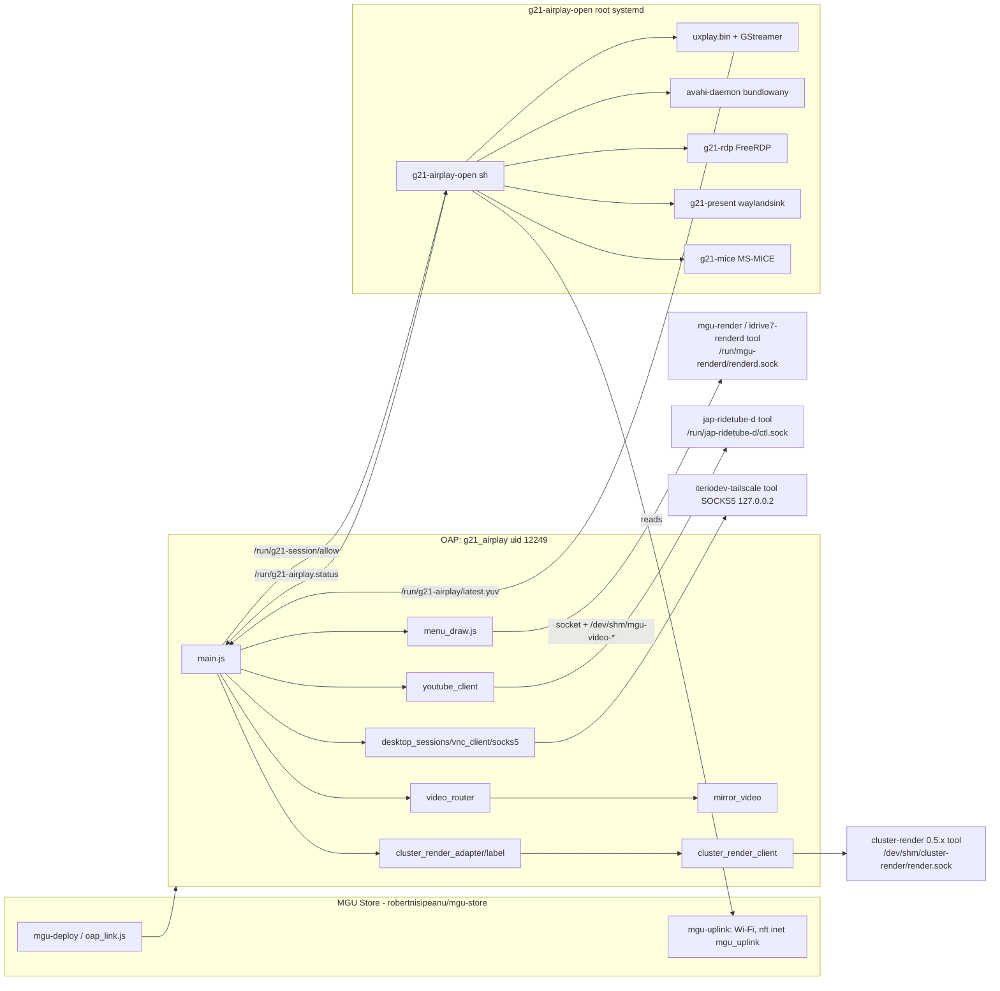

# Mapa repozytorium `1/` (thexozzz/idrive7-apps)

Źródło: listing katalogów 2026-11-14 i odczyt plików. Pominięto `.git/objects`, `third_party/` (kod obcy), `dev-staging/`, `dev-logs/`, binaria.

## Katalogi

| Ścieżka | Rola | Uwagi |
|---|---|---|
| `mgu-repo.json` | katalog Store: aplikacje `g21_hello`, `g21_airplay`; narzędzia `g21-airplay-open` 0.1.45, `jap-ridetube-d` 0.3.9 | czytane przez Store z czubka gałęzi `test` |
| `apps/g21_hello/` | szablon aplikacji RHMI (0.1.0) | `src/main.js` |
| `apps/g21_airplay/` | THEiPlay 0.1.121 | `mgu-app.json` (lista modułów!), `package/` (manifest, permissions, rhmiData, config, CHANGELOG), `src/` (30 modułów) |
| `native/g21-airplay-open/` | narzędzie backendu (root, systemd) | skrypt `g21-airplay-open` (1393 linii sh), binaria ELF, `lib/` (~GStreamer 1.14, FFmpeg, FreeRDP, avahi z Ubuntu 18.04), `component.json`, `.service` |
| `native/jap-ridetube-d/` | narzędzie YouTube (GPL-3.0, autor zewnętrzny) | `ytd.js`, `ytdec`, `ytdlp.pyz`, `ytfetch.py` |
| `lib/parked-gate.js` | re-eksport bramki postoju | 86 B |
| `tools/` | walidator, testy jednostkowe, symulator, bump wersji | `test_all.js` uruchamia 14 skryptów |
| `scripts/` | `build/test/publish/bump/diagnose/uninstall.ps1`, `dev/` (cykl SSH, HotPatch, rollback, skrypty zdalne) | patrz BUILD_AND_DEPLOY.md |
| `docs/` | wcześniejsza baza wiedzy (PL) + `docs/ai/` (ta) | |
| `third_party/UxPlay/` | UxPlay 1.73.7 **zmodyfikowany** (`renderers/video_renderer.c`: tee → `G21_YUV`) | GPL-3.0 |
| `third_party/ridetube/` | kopia aplikacji `jap_ridetube` 0.3.8 (GPL-3.0-or-later) | źródło `youtube_client.js` |
| `.github/workflows/` | `test.yml` (Node 22, `test_all.js`), `publish.yml` (ręczny check) | |
| `.cursor/rules/` | reguły Cursor: readonly, safety, screen, publish-test | publish-test sprzeczne z obecnymi zasadami |
| `dist/` | `publish-plan.json` | gitignored |

## Moduły `apps/g21_airplay/src/`

| Moduł | Odpowiedzialność |
|---|---|
| `main.js` (157 KB) | klasa `AirPlayApp` (OnlineApp): cykl życia OAP, sesje, ekrany, wideo, YouTube, sygnały SOME/IP, seed profilu RDP |
| `menu_draw.js` (141 KB) | klient renderera `mgu-render/1`: HELLO/PLACE/SHOW/FRAME/VIDEO/CLAIM, rysowanie menu prostokątami, dotyk, CCU, klawiatura |
| `knob_keyboard.js`, `qr.js` | klawiatura pokrętłem; kod QR (nowy, niezatwierdzony) |
| `mirror_video.js` | zapis klatek I420 do `/dev/shm/mgu-video-g21airplay` (MGVF, 4 sloty) |
| `video_decoder.js` | parsowanie `G21Y`, skalowanie I420 i atlas YUV dla cluster-render (CPU, JS) |
| `video_router.js` | pierścień 3 klatek, osobne FPS środek/zegary, `setParked` |
| `frame_fit.js` | contain/cover, rozmiary okien |
| `display_output.js`, `parked_gate.js` | wybór wyjścia, bramka prędkości |
| `cluster_render_client.js` | klient cluster-render (MPL-2.0, R. Nisipeanu) |
| `cluster_render_adapter.js`, `cluster_label.js` | cele `map`/`panel`/`hud`, napis na KOMBI/HUD |
| `session_manager.js`, `desktop_sessions.js` | jedna aktywna sesja; pliki `/run/g21-session/allow`, statusy |
| `desktop_settings.js`, `settings_manager.js`, `config_store.js`, `credentials.js` | profile RDP/VNC, ustawienia, sekrety w `data/*.secret` |
| `config_panel.js` | panel HTTP :1235 (konfiguracja RDP z telefonu) |
| `vnc_client.js`, `socks5.js` | klient RFB 3.8; SOCKS5 do Tailscale |
| `frame_bridge.js`, `frame_sink.js` | gniazdo `/run/g21-desktop/frame.sock` dla obrazu pulpitu |
| `input_manager.js` | mapowanie pokrętła/touchpada/ekranu na kursor |
| `windows_offers.js` | oferty Win+K z `/run/g21-desktop/offers` |
| `youtube_client.js`, `youtube_file.js` | sterowanie demonem `jap-ridetube-d` (kopia GPL) |
| `uplink.js` | stan `mgu-uplink` (`/run/mgu-uplink/status.json`) |
| `mdns.js`, `airplay.js` | pomocnicze (starsze; ogłoszenie robi narzędzie) |
| `paths.js` | ścieżki danych OAP |

## Mapa zależności

Zależności zadeklarowane w `mgu-repo.json` (`g21_airplay.requires`): `g21-airplay-open` 0.1.36, `cluster-render` 0.5.4, `jap-ridetube-d` 0.3.9. **Niezadeklarowane, a używane**: renderer `mgu-render`/`idrive7-renderd` (gniazdo renderd), `iteriodev-tailscale`, `mgu-uplink`. `jap-ridetube-d` wymaga `mgu-render` 0.6.11, `jap-node22`, `mgu-python`. — VERIFIED z plików JSON; ASSUMPTION, że renderer jest instalowany przez inne źródło.

Niespójność wersji: `apps/g21_airplay/release.json` wymaga `g21-airplay-open` 0.1.10 i `mgu-deploy` 0.4.0, `mgu-repo.json` — 0.1.36, a narzędzie ma 0.1.45. — VERIFIED.

## Git

- Gałęzie lokalne: `master` (`44bcf02`), `store-publish` (HEAD, `fd4c9d6`) śledząca `origin/test`; tag `airplay-pre-fix-20261112` (`77d109c`). Zdalne: `origin/master` `fdde01d`, `origin/test` `fd4c9d6`. — VERIFIED (`.git/refs`, `git ls-remote`).
- 116 wpisów w reflogu od 2026-11-11; ostatni commit „Put YouTube inside THEiPlay…” 2026-11-14 02:12 (współautor: Cursor agent).
- Niezatwierdzone zmiany w drzewie roboczym: `apps/g21_airplay/src/main.js`, `menu_draw.js`, nowy `qr.js`, `mgu-app.json` (+`src/qr.js`). — VERIFIED porównaniem z klonem `origin/test`. Nie ruszać.
- `git status` nie był uruchomiony (brak powłoki na komputerze właściciela w tej sesji).
